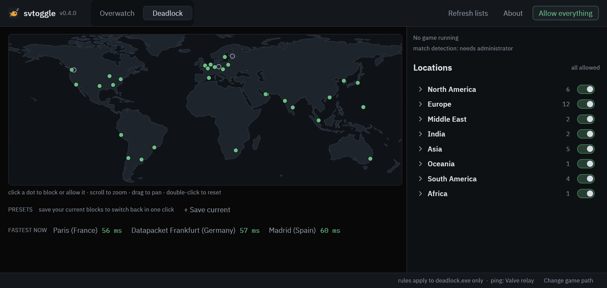

<p align="center"></p>

<h1 align="center">Deadlock &amp; Overwatch Server Selector</h1>

<p align="center">
  <b>svtoggle</b> picks which game server regions you can be matched on, for <b>Deadlock</b> and <b>Overwatch</b> on Windows.<br>
  World map, per-city toggles, ping per region, presets. Firewall rules only: no injection, game files untouched.
</p>

<p align="center">
  <a href="https://github.com/FishyShu/deadlock-overwatch-server-selector/releases/latest"><b>Download</b></a> ·
  <a href="https://fishyshu.github.io/deadlock-overwatch-server-selector/">Website</a> ·
  <a href="#faq">FAQ</a>
</p>



Looking for a **Deadlock region changer** (the old `citadel_region_override` console command no longer exists),
an **Overwatch server selector**, or a way to **block Middle East / Asia / NA servers**? That's what this is.

## Install
1. Download `svtoggle-gui.exe` from the latest release (or build it, see below).
2. Double-click it. It asks for admin once per launch, because firewall rules need it.

**Portable:** grab `svtoggle-portable.exe` instead (or rename any copy to contain "portable"). It's the same
single file, but it keeps presets and cached lists in a `svtoggle-data` folder beside itself, so it can live on a USB stick.

For launches without the UAC prompt, run `powershell -File scripts\install.ps1` once. It copies the
app to `%ProgramFiles%\svtoggle` (admin-only folder, since the task runs it elevated), registers a `svtoggle` scheduled task and makes Desktop
and Start Menu shortcuts that launch through it. Pin the Start Menu entry to the taskbar if you like.

## Using it
- **Switch on** = that region is reachable. **Switch off** = blocked. Click a dot on the map to do the same.
- Deadlock is grouped by area; the area switch flips every city in it, the chevron opens the cities.
- **Fastest now** lists the three lowest pings you can currently reach.
- **Presets**: block what you want, *Save current*, name it. One click (or the tray menu) brings it back. Right-click a preset to delete it.
- **Allow everything** turns off every svtoggle rule for both games.
- **Refresh lists** downloads the newest server lists and re-applies whatever you have blocked.
- While a game is running, the right panel shows which region your match is on.
- Closing the window keeps it in the tray. Right-click the tray icon to quit.

## How it works
- One outbound Block rule per region (`svtoggle <game> <region>`, group `svtoggle`), **scoped to the game's exe**, so other apps never lose those cloud ranges.
- Allow **disables** a rule, never deletes it.
- **Protected ranges**: list ranges you never want blocked (e.g. your nearest home region) in `%APPDATA%\svtoggle\protect.txt`, one CIDR per line. They're stripped from every region on load and any block touching them is refused.
- Overwatch ranges: a hand-verified Middle East list + [Qiiks/ow2-server-list](https://github.com/Qiiks/ow2-server-list) for the rest (community data, protected ranges stripped).
- Deadlock ranges: exact Valve relay IPs per city from `ISteamApps/GetSDRConfig` (appid 1422450). Cities that publish no relays (`dsto`, `eat`, `fsn`, `hel`) can't be blocked. Valve's coordinates for the Datapacket cities are wrong, so they borrow their twin city's.
- Ping: Overwatch = nearest AWS region (a proxy). Deadlock = ICMP to a real relay.
- Match detection: counts UDP packets on the game's own ports with a raw socket (admin only).

## CLI
```
svtoggle overwatch status
svtoggle deadlock block ams
svtoggle deadlock refresh
svtoggle monitor          # what match detection sees, once a second
```

## Undo everything
- App: `powershell -File scripts\install.ps1 -Uninstall` (task, shortcuts, folder).
- Rules, admin PowerShell: `Get-NetFirewallRule -Group svtoggle | Remove-NetFirewallRule`

## Build
`cargo build --release` → `target/release/svtoggle-gui.exe` (icon + admin manifest embedded, needs the Windows SDK) and `svtoggle.exe`. `cargo test` runs the guard tests.

## FAQ
**How do I change my server region in Deadlock?** `citadel_region_override` is gone from current builds. svtoggle blocks the Valve relay cities you don't want, so matchmaking can only use the rest.

**How do I block Overwatch Middle East servers?** Overwatch tab, switch off *Middle East*. The rule only applies to `Overwatch.exe`.

**Can this get me banned?** It never touches the game; it only adds Windows Firewall rules, like a router geo-filter. Use at your own risk, and don't switch regions mid competitive match: dropping out can count as leaving.

**Stuck on "connecting"?** You've probably blocked everything it wanted. Click *Allow everything*, then block fewer regions.

## Not verified yet
- Deadlock: whether the game fails over to another relay or refuses to connect when a city is blocked.
- Match detection during a real match, and the 20 pkt/s threshold.

License: MIT. Fonts: IBM Plex Sans / Mono, SIL Open Font License (`app/assets/fonts/OFL.txt`). Map: Natural Earth (public domain).
